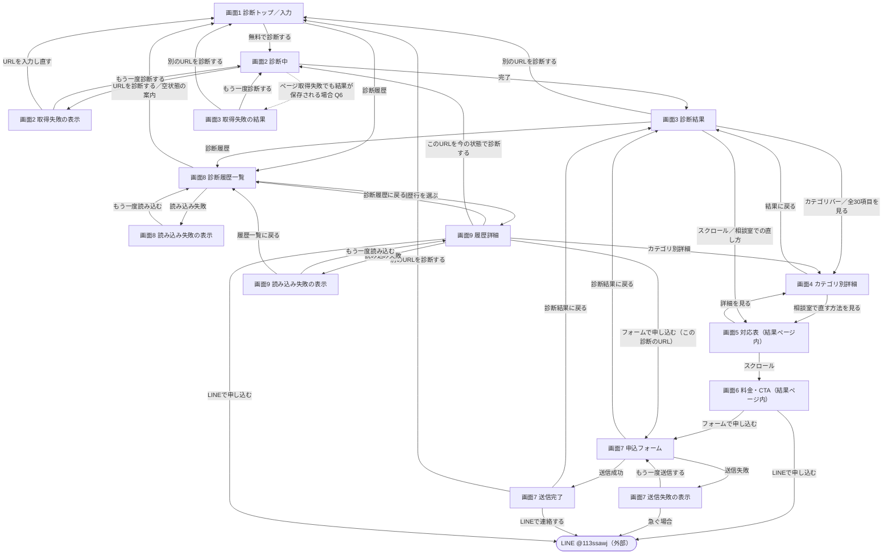

# 画面遷移図

GitHubなどMermaidを表示できる環境向けの図と、テキストだけで読める一覧の2つを載せています。内容は同じです。

## 遷移図（Mermaid）



画面9から開いた画面4と画面7の「戻る」は、画面3ではなく画面9に戻ります（図では線が多くなるため省略しています）。

## 遷移一覧（テキスト）

### 診断から申込まで（主な流れ）

```
画面1 入力 ──[無料で診断する]──▶ 画面2 診断中 ──[完了]──▶ 画面3 結果
                                                              │
        ┌─────────────────────────────────────────────────────┤
        │                                                     ▼ スクロール
        │                                              画面5 対応表
        │                                                     ▼ スクロール
        │                                              画面6 料金・CTA
        │                                               │            │
        │                                   [フォームで申し込む]  [LINEで申し込む]
        │                                               ▼            ▼
        │                                         画面7 フォーム   LINE（外部・別タブ）
        │                                               │
        │                                        [送信]─┴─▶ 送信完了
        │
        └──[カテゴリバー／全30項目を見る]──▶ 画面4 詳細 ──[結果に戻る]──▶ 画面3
```

### 失敗時の分岐と戻り先

| 起点 | 条件 | 行き先 | 戻る操作 |
| --- | --- | --- | --- |
| 画面2 診断中 | 診断がエラーになった | 画面2の失敗表示 | `もう一度診断する`（同じURLで画面2を再実行）／`URLを入力し直す`（画面1、入力欄に同じURLを残す） |
| 画面2 診断中 | 時間が長引いている | 画面2のまま（注意文を追加） | 操作なし。待つ |
| 画面3 結果 | ページ取得に失敗した結果が返った | 画面3の取得失敗ブロック | `もう一度診断する`／`別のURLを診断する` |
| 画面7 フォーム | 入力エラー | 画面7のまま（項目直下＋上部まとめ） | 修正して再送信 |
| 画面7 フォーム | 送信失敗 | 画面7のまま（ボタン直上に失敗表示、入力は保持） | `もう一度送信する`／LINEへ |
| 画面8 履歴一覧 | 読み込み失敗 | 画面8のエラー表示 | `もう一度読み込む` |
| 画面9 履歴詳細 | 読み込み失敗 | 画面9のエラー表示 | `もう一度読み込む`／`履歴一覧に戻る` |

### 各画面から戻れる場所

| 画面 | 戻れる場所と操作 |
| --- | --- |
| 画面1 入力 | （起点）ヘッダーの `診断履歴` → 画面8 |
| 画面2 診断中 | 通常は戻る操作なし。失敗時のみ画面1 |
| 画面3 結果 | ヘッダーの `別のURLを診断` と、ページ末尾の `別のURLを診断する` → 画面1。ヘッダーの `診断履歴` → 画面8 |
| 画面4 詳細 | `← 結果に戻る` → 画面3（画面9から開いた場合は画面9） |
| 画面5・6 | 結果ページ内のセクションなので、スクロールで画面3に戻る |
| 画面7 フォーム | `← 診断結果に戻る` → 画面3または画面9 |
| 画面7 完了 | `診断結果に戻る` → 画面3または画面9、`別のURLを診断する` → 画面1 |
| 画面8 履歴一覧 | ヘッダーの `URLを診断する` → 画面1 |
| 画面9 履歴詳細 | `← 診断履歴に戻る` → 画面8 |

ブラウザの「戻る」ボタンを押したときの挙動（たとえば画面3から戻ると画面2が再実行されないか）は実装で決まる部分のため、Q13 にまとめています。
