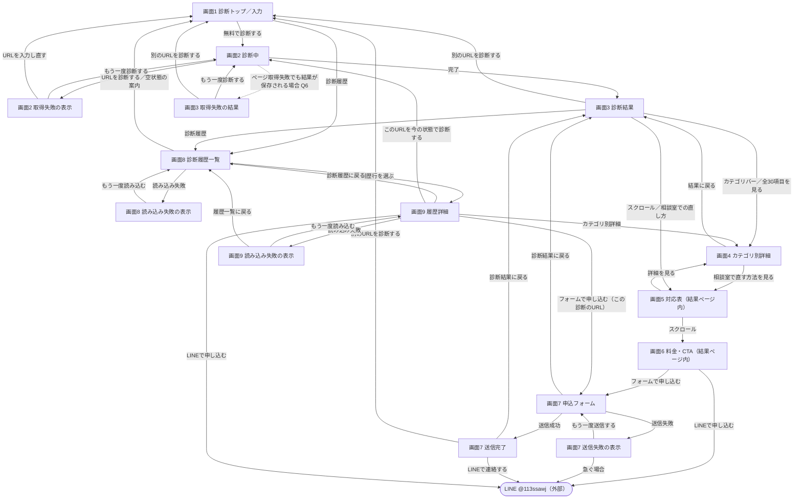

# SEO AIO AEO LLMO診断アプリ ワイヤーフレーム（全体版）

README、9画面のワイヤー、画面遷移図、コンポーネント一覧、未確定事項を1つにまとめたファイルです。

## SEO AIO AEO LLMO診断アプリ ワイヤーフレーム

さいたまホームページ相談室の無料診断申込につなげる診断アプリ（`seo-aio-aeo-llmozhen-duan-apuri`）について、見せ方を改善するためのワイヤーフレームです。グレースケールの低〜中忠実度で、情報の配置、優先順位、画面遷移、CTAの置き場所だけを決めています。配色、フォント、装飾、実装は含みません。

### 成果物

| # | ファイル | 内容 |
| --- | --- | --- |
| 1 | screens-01-02.md | 画面1 診断トップ／入力、画面2 診断中 |
| 1 | screens-03-06.md | 画面3 診断結果、画面4 カテゴリ別詳細、画面5 相談室の対応表、画面6 料金・プランとCTA |
| 1 | screens-07-09.md | 画面7 無料診断申込フォーム（送信中・失敗・完了を含む）、画面8 診断履歴一覧、画面9 履歴詳細 |
| 2 | flow.md | 画面遷移図（戻り先と失敗時の分岐を含む） |
| 3 | components.md | コンポーネント一覧と再利用関係 |
| 4 | open-questions.md | 未確定事項・確認質問、ワイヤー本体と分けた「提案」 |

9画面すべてにデスクトップ版とモバイル版を作り、各画面に次の5つの注記を付けています。

- 画面の目的
- 主要な操作
- 情報の優先順位（上から順）
- スマートフォンでの折り返しと固定CTA
- 空状態とエラー状態の置き場所

### 記法

ASCIIのワイヤーは、日本語の全角文字で右端の罫線がずれるため、枠の右側を省いています。左の罫線と上下の線で領域を示します。

| 記法 | 意味 |
| --- | --- |
| `┌─ 名前 ─` 〜 `└──` | 領域（セクション、カード） |
| `[ ボタン ]` | ボタン。`[[ ボタン ]]` は主ボタン（そのエリアでいちばん目立たせる操作） |
| `( 入力欄 )` | テキスト入力欄 |
| `<リンク>` | テキストリンク |
| `▶` / `▼` | 閉じた／開いたアコーディオン |
| `■■■■■□□□□□` | バーやゲージ（塗りの量だけで値を示す。色は使わない） |
| `{ … }` | 動的に入る値 |
| `※` | ワイヤー上の注記（画面には出さない設計メモ） |
| `≡` | 固定表示される領域（スクロールしても残る） |

#### 判定ラベルの表記

色を使わずに判別できるよう、記号と文字を必ずセットで出します。

| 判定 | ラベル | 記号の形 |
| --- | --- | --- |
| 合格 | `✓ 合格` | チェック |
| 要改善 | `△ 要改善` | 三角 |
| 不合格 | `✕ 不合格` | バツ |
| 確認不可 | `？ 確認不可` | 疑問符（枠は点線を想定） |

記号は形の違いだけで区別でき、ラベルの文字があるのでモノクロ印刷や色覚の違いがあっても読めます。

### 主要な設計判断（要約）

ワイヤーで解く5つの課題に対して、次のように決めました。理由は各画面の注記に書いています。

1. **専門用語の一言説明**：SEO、AIO、AEO、LLMOの一言説明は、ツールチップに隠さず、カテゴリ名の直下に常に表示します。スマートフォンにはホバーがなく、隠すと読まれないためです。入力画面、結果画面のカテゴリバー、カテゴリ別詳細のタブ直下の3か所で同じ文言を使います。
2. **結論を最初に見せる**：結果画面の最上部に「総合スコアとランク」「いちばん低いカテゴリ」「優先して直したいポイント」を集めた結論ブロックを置きます。30項目の詳細は別画面（画面4）に分け、結果画面に混ぜません。
3. **押し売りに見えないCTA**：申込ボタンは画面6の1か所にまとめます。その手前に、課題と直し方を組にした対応表（画面5）を必ず置きます。優先改善カードには大きなボタンを置かず、「相談室での直し方」という小さなリンクで対応表の該当行へ移動できるようにします。
4. **詳細をスマートフォンで読む**：画面4は、上部に固定するカテゴリタブと、判定ごとにまとめたチェック行の組み合わせを推奨します。合格の行は初期状態で畳みます。アコーディオン案と段階表示案との比較は画面4に載せています。
5. **フォームの負担を小さく見せる**：診断済みのURLを最初に確認済みの状態で見せ、残りの必須は3項目に見えるようにします。必須4項目と任意2項目を見出しで分け、任意は「空欄のままでも送れます」と明記します。1画面で完結させ、分割はしません。

### 今回の範囲外

- 最終デザイン（配色、フォント、装飾、ロゴや画像）
- コードの実装と既存アプリの改修
- 診断ロジック、スコア計算、チェック項目、優先度の付け方の変更
- 実装されていない機能の画面への追加（必要と考えたものは open-questions.md の「提案」に分けています）

## 画面1・画面2　入力と診断中

記法は [README.md](README.md#記法) を参照してください。文言はすべて仮で、確定した料金・特典・LINE情報以外は差し替えてかまいません。

---

### 画面1　診断トップ／入力画面

#### 注記

| 項目 | 内容 |
| --- | --- |
| 画面の目的 | 初めて来た人に「何が分かるか」「費用がかからないこと」を伝え、URL入力まで進めてもらう |
| 主要な操作 | URLの入力、「無料で診断する」の押下。副次的に、診断履歴への移動 |
| 情報の優先順位 | ①相談室の診断であることと診断名 → ②4つの視点で実測することと各用語の一言説明 → ③URL入力欄と「無料で診断する」 → ④診断で分かること（実際に取得するファイル、確認不可の扱い） → ⑤信頼材料（実測であること、取得できた範囲の結果であること） → ⑥相談室への軽い導線 |
| スマートフォン | 入力欄とボタンは縦に積み、どちらも画面幅いっぱいにする。②の4用語は1列の縦積み。入力欄とボタンを1画面目（ファーストビュー）に入れるため、②は入力欄の**下**に移す（デスクトップは上）。固定CTAは置かない（理由は下記） |
| 空状態 | 診断履歴がない場合、⑥の上にある「診断履歴」ブロックを「まだ診断履歴はありません。上の欄にURLを入れると、ここに結果が残ります」という1行に置き換える。ヘッダーの「診断履歴」リンクは常に出す |
| エラー状態 | 入力エラーは入力欄の**直下**に出す。①空のまま送信：「URLを入力してください」②形式が不正：「https:// から始まるURLを入力してください（例：https://example.com）」。エラー時は入力欄の枠を太くし、先頭に「✕」を付ける（色に頼らない） |

固定CTAを置かない理由：この画面で取ってほしい操作はURL入力の1つだけで、入力欄自体がファーストビューにあるためです。相談室への申込ボタンを固定すると、診断前に売り込まれている印象を与えます。

#### デスクトップ版

```
┌─ ヘッダー ─────────────────────────────────────────────────────────────────
│ さいたまホームページ相談室                                       <診断履歴>
└────────────────────────────────────────────────────────────────────────────

┌─ ① 診断名 ─────────────────────────────────────────────────────────────────
│ さいたまホームページ相談室の無料診断
│ ［診断名］SEO・AIO・AEO・LLMO 診断
│ あなたのホームページが、検索とAI検索でどう見えているかを実測します。
└────────────────────────────────────────────────────────────────────────────

┌─ ② 4つの視点 ──────────────────────────────────────────────────────────────
│ ┌ SEO ──────────┐ ┌ AIO ──────────┐ ┌ AEO ──────────┐ ┌ LLMO ─────────┐
│ │ Googleなどの  │ │ AI検索で自社が│ │ 質問への回答と│ │ AIクローラーに│
│ │ 検索で見つけて│ │ 引用・紹介され│ │ して拾われやす│ │ 正しく読み取ら│
│ │ もらうための  │ │ やすいか      │ │ い書き方か    │ │ れる構造か    │
│ │ 基礎          │ │               │ │               │ │               │
│ └───────────────┘ └───────────────┘ └───────────────┘ └───────────────┘
│ ※ 4枚は横並び。各カードは「略語（大）＋一言説明（常時表示）」だけ。
└────────────────────────────────────────────────────────────────────────────

┌─ ③ URL入力フォーム ────────────────────────────────────────────────────────
│ 診断したいページのURL
│ ( https://                                              ) [[ 無料で診断する ]]
│ ✕ URLを入力してください          ← エラー時のみ。入力欄の直下
│ 診断は無料です。登録は不要で、10秒ほどで結果が出ます。
└────────────────────────────────────────────────────────────────────────────

┌─ ④ 診断で分かること ─────────────┐ ┌─ ⑤ この診断について ─────────────────
│ 入力したURLのページに加えて、次の │ │ ・診断は実測です。推測の値は出しません。
│ ファイルを実際に取得して調べます。│ │ ・入力したページと関連ファイルを取得
│  ・ページ本体（HTML）             │ │   できた範囲の結果で、サイト全体の評価
│  ・robots.txt                     │ │   ではありません。
│  ・sitemap.xml                    │ │ ・取得できなかった項目は「確認不可」と
│  ・llms.txt ／ llms-full.txt      │ │   表示し、点数には含めません。
│ 30項目をチェックし、4つの視点で   │ │
│ 各100点、総合ランクS〜Dを出します。│ │
└───────────────────────────────────┘ └──────────────────────────────────────

┌─ 診断履歴（直近） ─────────────────────────────────────────────────────────
│ {78点 A} {example.com}  {2026/11/20 10:12}                    <すべて見る>
│ {64点 B} {example.jp}   {2026/11/18 15:40}
│ ※ 空状態：「まだ診断履歴はありません。上の欄にURLを入れると、ここに結果が残ります」
│ ※ 履歴の公開範囲は未確定（open-questions.md Q1）。決まるまで表示可否は保留。
└────────────────────────────────────────────────────────────────────────────

┌─ ⑥ 相談室への軽い導線 ─────────────────────────────────────────────────────
│ 結果を見て「自分では直せない」と感じたら、さいたまホームページ相談室に
│ 相談できます。料金の目安は診断結果のページで案内しています。
│ ※ ボタンは置かずテキストのみ。料金・プランの数字はここでは出さない。
└────────────────────────────────────────────────────────────────────────────

┌─ フッター ─────────────────────────────────────────────────────────────────
│ 診断の前提：実測値に基づく、取得できた範囲の結果です。
│ さいたまホームページ相談室
└────────────────────────────────────────────────────────────────────────────
```

#### モバイル版

```
┌─ ヘッダー ───────────────────
│ さいたまHP相談室    <履歴>
└──────────────────────────────
┌─ ① ─────────────────────────
│ さいたまホームページ相談室の
│ 無料診断
│ ［診断名］
│ SEO・AIO・AEO・LLMO 診断
│ 検索とAI検索での見え方を
│ 実測します。
└──────────────────────────────
┌─ ③ URL入力 ─────────────────
│ 診断したいページのURL
│ ( https://                 )
│ ✕ URLを入力してください
│   ↑ エラー時のみ、欄の直下
│ [[    無料で診断する     ]]
│ 無料・登録不要・約10秒
└──────────────────────────────
  ─ ここまでがファーストビュー ─
┌─ ② 4つの視点 ───────────────
│ SEO
│  Googleなどの検索で見つけて
│  もらうための基礎
│ ─────────────
│ AIO
│  AI検索で自社が引用・紹介
│  されやすいか
│ ─────────────
│ AEO
│  質問への回答として拾われ
│  やすい書き方か
│ ─────────────
│ LLMO
│  AIクローラーに正しく読み
│  取られる構造か
└──────────────────────────────
┌─ ④ 診断で分かること ────────
│ ページ本体と次のファイルを
│ 実際に取得して調べます。
│ ・robots.txt
│ ・sitemap.xml
│ ・llms.txt／llms-full.txt
│ 30項目・4視点で各100点、
│ 総合ランクS〜D
└──────────────────────────────
┌─ ⑤ この診断について ────────
│ ・実測で、推測値は出しません
│ ・取得できた範囲の結果です
│ ・取れない項目は「確認不可」
│   として点数に含めません
└──────────────────────────────
┌─ 診断履歴（直近） ──────────
│ {78点 A} {example.com}
│ {2026/11/20 10:12}
│ <すべて見る>
│ ※空状態は1行の案内文
└──────────────────────────────
┌─ ⑥ ─────────────────────────
│ 自分で直せない部分は、相談室
│ に相談できます（結果ページで
│ 案内します）
└──────────────────────────────
┌─ フッター ──────────────────
└──────────────────────────────
※ 固定CTAなし
```

---

### 画面2　診断中画面

#### 注記

| 項目 | 内容 |
| --- | --- |
| 画面の目的 | 取得と解析に10秒ほどかかっても離脱されないようにする |
| 主要な操作 | 基本的になし。エラー時のみ「もう一度診断する」「URLを入力し直す」 |
| 情報の優先順位 | ①診断中であることと対象URL → ②進み具合（取得している対象と解析の段階） → ③かかる時間の目安と、このまま待つよう伝える文 → ④何を見ているかの補足 |
| スマートフォン | 進捗の段階は1列の縦リスト。補足（④）は短く1ブロックにまとめ、スクロールしなくても①〜③が見えるようにする。固定CTAは置かない（待つ以外の操作を促さないため） |
| 空状態 | なし |
| エラー状態 | ②の進捗リストの**直上**に差し替えて出す（下記の2種類）。進捗リストは残し、どこで止まったかが分かるようにする |

##### 進捗の段階

現在の実装がどこまで段階ごとの進捗を返せるかは未確定です（open-questions.md Q4）。段階ごとの状態が取れない場合は、同じ並びを「順に確認しています」という説明として静的に表示し、全体は不確定型のインジケーターにします。

| 段階 | 表示名（仮） | 状態の表記 |
| --- | --- | --- |
| 1 | ページ本体を取得 | `○ 待機` → `◐ 取得中` → `● 完了` ／ `？ 取得できず` |
| 2 | robots.txt を取得 | 同上 |
| 3 | sitemap.xml を取得 | 同上 |
| 4 | llms.txt ／ llms-full.txt を取得 | 同上 |
| 5 | 4つの視点で採点 | `○` → `◐ 解析中` → `● 完了` |

ページ本体以外のファイルが取れなかった場合は「？ 取得できず（確認不可として扱います）」と出して先へ進みます。失敗ではないことを文で伝えます。

##### エラーの種類

| 種類 | 出す条件 | 文言（仮） | 操作 |
| --- | --- | --- | --- |
| 長引いている | 目安の時間を超えた（秒数は未確定、Q5） | 「いつもより時間がかかっています。相手のサイトの応答を待っています。このままお待ちください。」 | なし（待つ）。進捗は継続 |
| 失敗 | 診断処理自体がエラーを返した | 「診断できませんでした。URLが正しいか、サイトが公開されているかをご確認ください。」 | `[[ もう一度診断する ]]`（同じURLで再試行）、`<URLを入力し直す>`（画面1へ、入力欄に同じURLを残す） |

ページ本体の取得に失敗しても診断結果が保存される実装の場合は、この画面ではなく画面3の「取得失敗の結果」として見せます（画面3の注記参照）。どちらになるかは Q6 で確認します。

#### デスクトップ版

```
┌─ ヘッダー ─────────────────────────────────────────────────────────────────
│ さいたまホームページ相談室                                       <診断履歴>
└────────────────────────────────────────────────────────────────────────────

┌─ ① ────────────────────────────────────────────────────────────────────────
│ 診断しています
│ 対象：{https://example.com/}
└────────────────────────────────────────────────────────────────────────────

┌─ エラー表示位置（通常は非表示） ───────────────────────────────────────────
│ ✕ 診断できませんでした。URLが正しいか、サイトが公開されているかを
│   ご確認ください。
│   [[ もう一度診断する ]]   <URLを入力し直す>
└────────────────────────────────────────────────────────────────────────────

┌─ ② 進捗表示 ───────────────────────────────────────────────────────────────
│ ● ページ本体を取得                   完了
│ ● robots.txt を取得                  完了
│ ◐ sitemap.xml を取得                 取得中…
│ ○ llms.txt ／ llms-full.txt を取得
│ ○ 4つの視点で採点
│ ■■■■■■□□□□  ← 段階が取れない場合は不確定型（流れる帯）に置き換え
└────────────────────────────────────────────────────────────────────────────

┌─ ③ ────────────────────────────────────────────────────────────────────────
│ 10秒ほどかかります。このままお待ちください。
│ ※ 画面を離れた場合の扱いは未確定（Q3）。決まるまで「離れても大丈夫」とは書かない。
└────────────────────────────────────────────────────────────────────────────

┌─ ④ いま見ていること ───────────────────────────────────────────────────────
│ ページのタイトルや見出し、画像の説明文、AI向けの案内ファイル（llms.txt）、
│ AIの読み取りを許可しているか（robots.txt）などを、実際に取得して確認しています。
└────────────────────────────────────────────────────────────────────────────
```

#### モバイル版

```
┌─ ヘッダー ───────────────────
│ さいたまHP相談室    <履歴>
└──────────────────────────────
┌─ ① ─────────────────────────
│ 診断しています
│ {https://example.com/}
│ ※長いURLは折り返す
└──────────────────────────────
┌─ エラー位置（通常非表示）───
│ ✕ 診断できませんでした。
│ URLとサイトの公開状況を
│ ご確認ください。
│ [[  もう一度診断する  ]]
│ <URLを入力し直す>
└──────────────────────────────
┌─ ② 進捗 ────────────────────
│ ● ページ本体        完了
│ ● robots.txt        完了
│ ◐ sitemap.xml       取得中
│ ○ llms.txt／full
│ ○ 採点
└──────────────────────────────
┌─ ③ ─────────────────────────
│ 10秒ほどかかります。
│ このままお待ちください。
└──────────────────────────────
┌─ ④ ─────────────────────────
│ タイトル、見出し、画像の説明、
│ AI向けファイルなどを実際に
│ 取得して確認しています。
└──────────────────────────────
※ 固定CTAなし
```

## 画面3〜画面6　診断結果と申込への導線

記法は [README.md](README.md#記法) を参照してください。`{ }` の中の数値は配置を示すための例で、実際の診断値ではありません。

### 結果ページ全体の構成

画面3、画面5、画面6は1枚の結果ページの中のセクションです。画面4（カテゴリ別詳細）だけは、結果ページから開く下層ページに分けます。

```
結果ページ（1枚・縦スクロール）
├─ 画面3 診断結果
│   ├─ A 診断情報（URL・取得日時・HTTPステータス・前回比）
│   ├─ B 結論ブロック（スコアゲージ＋ランク＋いちばん低いカテゴリ）
│   ├─ C カテゴリバー ×4（一言説明つき）──────────→ 画面4（該当タブ）
│   ├─ D 実測サマリー
│   ├─ E 優先して直したいポイント（上位6件）──────→ 画面5の該当行へ移動
│   └─ F カテゴリ別詳細への入口 ──────────────────→ 画面4
├─ 画面5 相談室で改善できる内容（対応表）
├─ 画面6 料金・プランとCTA ───────────────────────→ 画面7 ／ LINE（外部）
└─ 別のURLを診断する ─────────────────────────────→ 画面1

画面4 カテゴリ別詳細（下層ページ）
└─ ← 結果に戻る ──────────────────────────────────→ 結果ページ
```

画面4を分ける理由：結果ページは「結論 → 課題と直し方 → 料金と申込」という一本の流れで読ませたいページです。30項目の詳細を同じページに入れると、モバイルでは対応表と料金までの距離が非常に長くなり、結論と申込の間が切れます。詳細を見たい人だけが下層ページへ進む形にします。

---

### 画面3　診断結果画面

#### 注記

| 項目 | 内容 |
| --- | --- |
| 画面の目的 | 結果の結論（今どういう状態か）と次の一手（何を直すか）を最初に伝える |
| 主要な操作 | ①カテゴリバーまたは「全30項目の判定を見る」でカテゴリ別詳細を開く ②「別のURLを診断する」で画面1へ戻る ③対応表と料金を経て無料診断へ進む |
| 情報の優先順位 | ①診断情報（URL、取得日時、HTTPステータス、前回比） → ②総合スコアとランク（スコアゲージ） → ③4カテゴリのスコア（カテゴリバー、一言説明つき） → ④実測サマリー → ⑤優先して直したいポイント（上位6件） → ⑥カテゴリ別詳細への入口 → ⑦相談室で改善できる内容へのつながり |
| スマートフォン | ゲージとカテゴリバーを縦に積む。**モバイルのみ④と⑤の順序を入れ替え**、優先改善リストを実測サマリーより先に出す（下記）。固定CTAは画面5の見出しが画面に入ってから表示する（画面6の注記で詳述） |
| 空状態 | なし |
| エラー状態 | (a) ページ取得に失敗した結果：②〜⑤を「取得失敗ブロック」に差し替える（下記）。(b) 確認不可が多い：②の結論ブロックの直下に注記帯を出す |

##### モバイルで④と⑤を入れ替える理由

仕様では「優先改善リストまでを1画面目で見せる」ことが求められています。実測サマリーの6項目を先に置くと、375×667pxクラスの画面では優先改善リストが2〜3画面目に下がります。実測サマリーは根拠情報で、結論を読んだ後に確かめるものなので、後ろに回しても判断に支障はありません。それでも1画面目に入るのは「優先改善リストの見出しと1件目」までになる見込みです。1画面目の範囲は下のワイヤーに線で示しています。デスクトップは横幅に余裕があるため、仕様どおりの順序のまま2列で収めます。

##### 結論ブロックの「いちばん低いカテゴリ」

4カテゴリのうち点数がいちばん低いものを「いちばん低いカテゴリ」として名前、点数、一言説明を並べます。新しい計算ではなく、既存の4つの点数の比較だけで出せる表示です。同点の扱いと、すべて高得点の場合に出すかどうかは Q8 で確認します。

##### 前回比

同じURLの前回診断がある場合だけ、「前回 {72}点 → 今回 {78}点（+6）」と符号つきで出します。上がったか下がったかは、色ではなく「+」「−」の符号と「▲」「▼」の記号で示します。前回診断がない場合は、この行ごと出しません（「前回比：なし」とも書かない）。

##### HTTPステータス

専門用語なので、数字に平易な説明を添えます。

| 値 | 表示（仮） |
| --- | --- |
| 200番台 | `HTTP {200}（正常に取得できました）` |
| 300番台 | `HTTP {301}（転送されています）` ※転送先を診断したかどうかの表示は Q7 |
| 400・500番台 | `HTTP {404}（ページが見つかりませんでした）` など |
| 取れていない | `HTTP 取得できず` → 取得失敗ブロックを出す |

##### エラー状態 (a)：ページ取得に失敗した結果

HTTPステータスが取れていない、またはページ本体が取得できなかった結果では、点数を出しても意味が伝わりません。結論ブロックの位置に次のブロックを出し、カテゴリバー、実測サマリー、優先改善リストは出しません。

- 見出し：「ページを取得できなかったため、診断できませんでした」
- 考えられる原因：URLの入力ミス、サイトが非公開、一時的な不具合、アクセス制限
- 操作：`[[ もう一度診断する ]]` `<別のURLを診断する>`
- 画面5と画面6は出さず、「サイトが表示されない、つながらないといったご相談も受け付けています」という1行と、LINEへのテキストリンクだけを置く（出すかどうかは Q6）

##### エラー状態 (b)：確認不可が多い

確認不可の項目が一定数以上ある場合（しきい値は Q9）、結論ブロックの直下に注記帯を出します。

```
│ ？ 確認不可の項目が {7} 件あります。取得できなかった項目は点数に含めていない
│   ため、総合スコアは取得できた {23} 項目だけで計算した結果です。<どの項目か見る>
```

`<どの項目か見る>` は画面4を開き、確認不可の行が見える位置に移動します。

#### デスクトップ版

```
┌─ ヘッダー ─────────────────────────────────────────────────────────────────
│ さいたまホームページ相談室                         <診断履歴> <別のURLを診断>
└────────────────────────────────────────────────────────────────────────────

┌─ A 診断情報 ───────────────────────────────────────────────────────────────
│ 診断結果  {https://example.com/}
│ 取得日時 {2026/11/20 10:12}   HTTP {200}（正常に取得できました）
│ 前回 {72}点 → 今回 {78}点（▲ +6）  ← 同じURLの前回診断がある場合のみ
└────────────────────────────────────────────────────────────────────────────

┌─ B 結論ブロック ──────────────────┐ ┌─ C カテゴリバー ──────────────────────
│        総合スコア                 │ │ SEO   {97}点 ■■■■■■■■■□
│      ╭───────────╮               │ │   Googleなどの検索で見つけてもらうための基礎
│      │  {78}     │  ランク        │ │ AIO   {88}点 ■■■■■■■■□□
│      │  /100     │   {A}          │ │   AI検索で自社が引用・紹介されやすいか
│      ╰───────────╯               │ │ AEO   {33}点 ■■■□□□□□□□  ← いちばん低い
│ ランクはS〜Dの5段階 ※基準はQ10   │ │   質問への回答として拾われやすい書き方か
│ ─────────────────                 │ │ LLMO  {93}点 ■■■■■■■■■□
│ いちばん低いカテゴリ              │ │   AIクローラーに正しく読み取られる構造か
│ AEO {33}点                        │ │ ※ 各行クリックで画面4の該当タブを開く
│ 質問への回答として拾われやすい書き│ │ ※「いちばん低い」は文字ラベルで示す
│ 方か                              │ │
└───────────────────────────────────┘ └──────────────────────────────────────
│ ？ 確認不可の項目が{7}件あります…（エラー状態(b)のときのみ、B・Cの直下に全幅）

┌─ D 実測サマリー ───────────────────────────────────────────────────────────
│ ┌タイトル────┐┌説明文──────┐┌本文量──────┐┌画像のalt───┐┌リンク──────┐┌構造化データ┐
│ │{32}文字    ││{118}文字   ││{2,400}文字 ││{12}枚中    ││内部{24}件  ││{Organiza-  │
│ │            ││            ││            ││{3}枚未設定 ││外部{5}件   ││tion}ほか{2}│
│ └────────────┘└────────────┘└────────────┘└────────────┘└────────────┘└────────────┘
│ ※ 値のみを出し、良し悪しの判定はチェック行（画面4）に任せる。
│ ※ 各タイルの見出しにも短い説明を付けるか（例：説明文＝検索結果に出る紹介文）は Q11。
└────────────────────────────────────────────────────────────────────────────

┌─ E 優先して直したいポイント ───────────────────────────────────────────────
│ 点数への影響が大きい順に、上位6件を表示しています。
│ ┌─────────────────────────────────────────────────────────────────────────
│ │ 1  ✕ 不合格  FAQの設置            AEO   優先度：高
│ │    よくある質問と答えをページに載せると、質問への回答として拾われやすく
│ │    なります。{改善案の文}                          <相談室での直し方 ↓>
│ ├─────────────────────────────────────────────────────────────────────────
│ │ 2  ✕ 不合格  FAQ構造化データ      AEO   優先度：高
│ │    {改善案の文}                                    <相談室での直し方 ↓>
│ ├─────────────────────────────────────────────────────────────────────────
│ │ 3  △ 要改善  質問形式の見出し      AEO   優先度：中        …（6件まで）
│ └─────────────────────────────────────────────────────────────────────────
│ ※ 大きな申込ボタンは置かない。<相談室での直し方 ↓> は画面5の該当行へ移動。
│ ※ 空状態：要改善・不合格が0件なら「直すべき項目は見つかりませんでした」と出し、
│   画面5の「すべて合格」の文面へつなぐ。
└────────────────────────────────────────────────────────────────────────────

┌─ F カテゴリ別詳細への入口 ─────────────────────────────────────────────────
│ 30項目すべての判定と実測値を確認できます。
│ [ 全30項目の判定を見る → ]   SEO {11}項目 ／ AIO {7} ／ AEO {6} ／ LLMO {6}
└────────────────────────────────────────────────────────────────────────────

（この下に 画面5 → 画面6 → 「別のURLを診断する」→ フッター が続く）
```

#### モバイル版

```
┌─ ヘッダー ───────────────────
│ さいたまHP相談室    <履歴>
└──────────────────────────────
┌─ A 診断情報 ────────────────
│ {example.com/}
│ {2026/11/20 10:12} 取得
│ HTTP {200}（正常に取得）
│ 前回{72}→今回{78}（▲+6）
└──────────────────────────────
┌─ B 結論 ────────────────────
│ 総合 {78}/100   ランク {A}
│ ■■■■■■■■□□
│ いちばん低い：AEO {33}点
│ 質問への回答として拾われ
│ やすい書き方か
└──────────────────────────────
│ ？確認不可{7}件…（該当時のみ）
┌─ C カテゴリ ────────────────
│ SEO  {97} ■■■■■■■■■□  ›
│  検索で見つけてもらう基礎
│ AIO  {88} ■■■■■■■■□□  ›
│  AI検索で引用・紹介されるか
│ AEO  {33} ■■■□□□□□□□  ›
│  質問の回答に拾われやすいか
│ LLMO {93} ■■■■■■■■■□  ›
│  AIに正しく読み取られる構造か
└──────────────────────────────
┌─ E 優先して直したい点 ──────
│ 1 ✕不合格  優先度：高
│   FAQの設置（AEO）
  ─ ここまでが1画面目の見込み ─
│   {改善案の文 2行まで}
│   <相談室での直し方 ↓>
│ ──────────
│ 2 ✕不合格  優先度：高
│   FAQ構造化データ（AEO）
│   {改善案}  <直し方 ↓>
│ ──────────
│ … 6件まで
└──────────────────────────────
┌─ D 実測サマリー ────────────
│ タイトル     {32}文字
│ 説明文       {118}文字
│ 本文量       {2,400}文字
│ 画像のalt    {12}枚中{3}枚未設定
│ リンク       内部{24}／外部{5}
│ 構造化データ {Organization}他
│ ※2列の「名前｜値」の行で縦積み
└──────────────────────────────
┌─ F ─────────────────────────
│ [ 全30項目の判定を見る → ]
└──────────────────────────────
（画面5 → 画面6 → 別のURLを診断 → フッター）

≡ 固定CTA：画面5の見出しが入ってから
  表示（画面6の注記参照）
```

モバイルのカテゴリバーの一言説明は、横幅に収めるため短縮形を使っています。短縮形を使うか、仕様の文言どおり2行に折り返すかは Q12 で確認します。

---

### 画面4　カテゴリ別詳細

#### 注記

| 項目 | 内容 |
| --- | --- |
| 画面の目的 | カテゴリごとに全チェックの判定と根拠（実測値）を見せる |
| 主要な操作 | カテゴリの切り替え、合格行の開閉、結果ページへ戻る |
| 情報の優先順位 | ①戻るリンクと診断対象URL → ②カテゴリタブ（4つ、点数つき） → ③選んだカテゴリの一言説明と判定の内訳 → ④不合格の行 → ⑤要改善の行 → ⑥確認不可の行 → ⑦合格の行（初期は畳む） → ⑧結果ページの対応表へ戻るリンク |
| スマートフォン | カテゴリタブは画面上部に固定。チェック行は「判定ラベル＋優先度 → チェック名 → 実測値 → 改善案」の順に縦に積む。表形式は使わない。固定CTAは置かない（詳細を確かめる画面のため） |
| 空状態 | 選んだカテゴリに要改善と不合格がない場合、④⑤の位置に「このカテゴリで直すべき項目はありません」と合格件数を出す |
| エラー状態 | この画面固有のエラーはない。確認不可の行の見せ方を下記で定める。画面9から開いた場合の読み込み失敗は画面9に従う |

**独立画面にするか、結果画面の一部にするか**：結果ページの下層の独立画面を提案します（理由は冒頭の「結果ページ全体の構成」）。結果ページから開くときは、押したカテゴリのタブを選んだ状態で開きます。戻ったときに結果ページの元の位置に戻れるかは実装次第のため Q13 に入れています。

##### 表示方式の比較

例として「AEOの課題をすべて見る」「SEOからLLMOへ移る」という2つの操作で比べます。

| 案 | 内容 | AEOの課題を全部見る | SEO→LLMOへ移る | 利点 | 欠点 |
| --- | --- | --- | --- | --- | --- |
| A タブ＋判定ごとのまとめ（推奨） | 上部固定のタブで4カテゴリを切り替え、各カテゴリ内は不合格→要改善→確認不可→合格の順に並べ、合格は畳む | タブ1回 | タブ1回（固定なのでスクロール不要） | 移動が常に1タップ。課題が先頭に集まり、開閉しなくても読める | 4カテゴリを一度に見比べられない。タブ名が略語なので一言説明を別に出す必要がある |
| B カテゴリのアコーディオン | 4カテゴリを見出しとして縦に並べ、開いたものだけ中身を出す | 見出し1回 | 上へ戻るスクロール＋閉じる1回＋開く1回 | 全カテゴリの点数が一覧できる。実装が単純 | 開いた中身が長いと、次のカテゴリの見出しが遠くなる。チェック行まで畳むと操作回数がさらに増える |
| C 段階表示 | まず全カテゴリの不合格と要改善だけを出し、「合格と確認不可も見る」で全件を出す | 0回（最初から見える） | カテゴリの区切りまでスクロール | 直すべき点だけを最短で読める | 全件表示にすると30行が1列に並び、カテゴリ間の移動手段がなくなる |

推奨はAです。Cの「課題を先に、合格は後で」という考え方は、Aの各タブの中に取り込んでいます。デスクトップ版とモバイル版で方式は変えません。結果ページから特定カテゴリを開く導線が両方にあり、方式が同じほうが説明を共通にできるためです。デスクトップでは横幅が余る分、チェック行を2列のカード（左：判定・名前・実測値、右：改善案）にします。

##### チェック行の構成

| 要素 | 出す条件 | 表記 |
| --- | --- | --- |
| 判定ラベル | 常に | `✓ 合格` `△ 要改善` `✕ 不合格` `？ 確認不可` |
| 優先度 | 常に（合格行では省略してよいかは Q14） | `優先度：高／中／低` |
| チェック名 | 常に | 「診断項目の一覧」の名称そのまま |
| 実測値 | 確認不可以外 | `実測：{32}文字` のように「実測：」に続けて値 |
| 改善案 | 要改善・不合格のみ | 囲み枠の中に文章 |
| 確認不可の説明 | 確認不可のみ | `実測：取得できませんでした` と「取得できなかったため、スコアに含めていません」 |

確認不可の行は、判定ラベルの枠を点線にし、行全体を一段控えめな表示（文字を細くするなど、色以外の手段）にします。失敗ではなく「分からなかった」ことが伝わるようにするためです。

#### デスクトップ版

```
┌─ ヘッダー ─────────────────────────────────────────────────────────────────
│ さいたまホームページ相談室                         <診断履歴> <別のURLを診断>
└────────────────────────────────────────────────────────────────────────────
<← 結果に戻る>   {https://example.com/} の診断（{2026/11/20 10:12}）

┌─ カテゴリ切替（上部固定）≡ ─────────────────────────────────────────────────
│ [ SEO {97} ] [ AIO {88} ] [■AEO {33}■] [ LLMO {93} ]   ← 選択中は反転＋下線
└────────────────────────────────────────────────────────────────────────────

┌─ AEO ──────────────────────────────────────────────────────────────────────
│ 質問への回答として拾われやすい書き方か
│ 6項目：✕ 不合格 {2} ／ △ 要改善 {1} ／ ？ 確認不可 {0} ／ ✓ 合格 {3}
└────────────────────────────────────────────────────────────────────────────

┌─ チェック行 ───────────────────────────────────────────────────────────────
│ ✕ 不合格  優先度：高           │ 改善案
│ FAQの設置                      │ よくある質問と答えを、ページ内に見出しつきで
│ 実測：FAQ {0}件                │ まとめて載せます。{改善案の文}
├────────────────────────────────┼───────────────────────────────────────────
│ ✕ 不合格  優先度：高           │ 改善案
│ FAQ構造化データ                │ {改善案の文}
│ 実測：FAQPage {なし}           │
├────────────────────────────────┼───────────────────────────────────────────
│ △ 要改善  優先度：中           │ 改善案
│ 質問形式の見出し               │ {改善案の文}
│ 実測：{0}／{8}見出し           │
└────────────────────────────────┴───────────────────────────────────────────
│ ▶ 合格した項目を見る（{3}件）
│   ▼ 開いたとき：定義文（〜とは）の有無 ／ 簡潔な文の割合 ／ 箇条書き・表の活用
│     （各行は 判定・名前・実測値のみ。改善案の列は出さない）

┌─ 確認不可の行の例（LLMOタブ） ─────────────────────────────────────────────
│ ┊？ 確認不可┊ 優先度：低       │ 取得できなかったため、スコアに含めていません。
│ llms-full.txt の設置           │
│ 実測：取得できませんでした     │
└────────────────────────────────┴───────────────────────────────────────────

┌─ 空状態の例 ───────────────────────────────────────────────────────────────
│ このカテゴリで直すべき項目はありません（合格 {11}件）。
│ ▶ 合格した項目を見る（{11}件）
└────────────────────────────────────────────────────────────────────────────

<このカテゴリの課題を相談室で直す方法を見る →>（結果ページの画面5へ）
<← 結果に戻る>
```

#### モバイル版

```
<← 結果に戻る>
{example.com/}
┌─ カテゴリ切替 ≡（上部固定）─
│[SEO][AIO][■AEO■][LLMO]
│ 97   88    33    93
└──────────────────────────────
┌─ AEO ───────────────────────
│ 質問への回答として拾われ
│ やすい書き方か
│ ✕{2} △{1} ？{0} ✓{3}
└──────────────────────────────
┌─ チェック行 ────────────────
│ ✕ 不合格    優先度：高
│ FAQの設置
│ 実測：FAQ {0}件
│ ┌改善案─────────────────
│ │ よくある質問と答えを、
│ │ 見出しつきで載せます。
│ └───────────────────────
├──────────────────────────────
│ ✕ 不合格    優先度：高
│ FAQ構造化データ
│ 実測：FAQPage {なし}
│ ┌改善案───────────────
│ │ {改善案の文}
│ └───────────────────────
├──────────────────────────────
│ △ 要改善    優先度：中
│ 質問形式の見出し
│ 実測：{0}／{8}見出し
│ ┌改善案───────────────
│ │ {改善案の文}
│ └───────────────────────
└──────────────────────────────
▶ 合格した項目を見る（{3}件）

確認不可の行（例）
┌──────────────────────────────
│ ┊？確認不可┊ 優先度：低
│ llms-full.txt の設置
│ 実測：取得できませんでした
│ 取得できなかったため、
│ スコアに含めていません。
└──────────────────────────────

<相談室で直す方法を見る →>
※ 固定CTAなし
```

---

### 画面5　相談室で改善できる内容の対応表（結果ページ内セクション）

#### 注記

| 項目 | 内容 |
| --- | --- |
| 画面の目的 | 診断で出た課題と、相談室での直し方を1対1で対応づけて見せる |
| 主要な操作 | 読むこと。行ごとに `<詳細>` で画面4の該当行へ移動できる。読み終えたら画面6へ |
| 情報の優先順位 | ①見出しと、この結果をもとにした提案理由の文 → ②対応表（不合格と要改善を最大8件、課題が先・直し方が後） → ③8件を超えた分の案内 → ④すべて合格だった場合の文面（該当時のみ①〜③と差し替え） → ⑤画面6へのつなぎ |
| スマートフォン | 2列の表にせず、「課題」と「相談室での直し方」を1組のカードにして縦に積む。カード内は課題が上、直し方が下。固定CTAはこのセクションの見出しが画面に入った時点で表示を始める |
| 空状態 | すべて合格の場合。対応表の代わりに、状態を保ちながら集客を伸ばす更新運用の提案文を出す |
| エラー状態 | なし |

並び順は、優先改善リスト（画面3のE）と同じ優先度順にします。結果画面で見た順位と対応表の順位が一致するので、`<相談室での直し方 ↓>` から移動したときに迷いません。

「相談室での直し方」の文言を、チェック項目ごとに既存アプリが持っているかどうかは未確認です（Q15）。

#### デスクトップ版

```
┌─ 画面5 見出し ─────────────────────────────────────────────────────────────
│ この結果から、相談室で直せること
│ {AEO（質問への回答として拾われやすい書き方か）が33点}と低く、直したい項目が
│ {5}件見つかりました。それぞれ、さいたまホームページ相談室では次のように直します。
└────────────────────────────────────────────────────────────────────────────

┌─ 対応表 ───────────────────────────────────────────────────────────────────
│ 課題（この診断で見つかったこと）       │ 相談室での直し方
├────────────────────────────────────────┼───────────────────────────────────
│ 1 ✕ 不合格  FAQの設置（AEO）     <詳細>│ {お客様への質問を整理し、FAQページを
│                                        │  作成・追加します}
├────────────────────────────────────────┼───────────────────────────────────
│ 2 ✕ 不合格  FAQ構造化データ（AEO）<詳細>│ {FAQに検索・AI向けの構造化データを
│                                        │  設定します}
├────────────────────────────────────────┼───────────────────────────────────
│ 3 △ 要改善  質問形式の見出し（AEO）     │ {…}
│ …                                      │ …（最大8件）
└────────────────────────────────────────┴───────────────────────────────────
│ ほかに {3} 件あります。<カテゴリ別詳細で見る>   ← 9件以上のときのみ

（すべて合格の場合、見出し以下を次に差し替え）
┌─ すべて合格 ───────────────────────────────────────────────────────────────
│ 今回の診断では、すべての項目が合格でした。
│ この状態を保ちながら、情報の更新を続けて集客を伸ばしていくことをご提案します。
│ 相談室では、更新代行（月10件まで）と毎月1ページの追加、AI検索対策（AIO・AEO・
│ LLMO）の継続に対応しています。 ※プランごとの範囲は Q16
└────────────────────────────────────────────────────────────────────────────

│ 料金の目安と、無料診断のお申し込みは下のとおりです。 ↓（画面6へ）
```

#### モバイル版

```
┌─ 画面5 ─────────────────────
│ この結果から、相談室で
│ 直せること
│ {AEOが33点}と低く、直したい
│ 項目が{5}件ありました。
│ 相談室では次のように直します。
└──────────────────────────────
┌─ 対応表の行 1 ──────────────
│ 課題
│ ✕ 不合格  FAQの設置（AEO）
│ ↓
│ 相談室での直し方
│ {お客様への質問を整理し、
│  FAQページを作成・追加}
│ <詳細を見る>
└──────────────────────────────
┌─ 対応表の行 2 ──────────────
│ 課題
│ ✕ 不合格 FAQ構造化データ
│ ↓
│ 相談室での直し方
│ {…}
└──────────────────────────────
… 最大8件
ほかに{3}件 <詳細で見る>

（すべて合格のとき）
┌─────────────────────────────
│ すべての項目が合格でした。
│ この状態を保ちながら、更新を
│ 続けて集客を伸ばす運用を
│ ご提案します。
└──────────────────────────────

≡ 固定CTA（ここから表示開始）
```

---

### 画面6　料金・プラン提示とCTA（結果ページ内セクション）

#### 注記

| 項目 | 内容 |
| --- | --- |
| 画面の目的 | 料金の目安を示したうえで、無理のない形で無料診断の申込へ進めてもらう |
| 主要な操作 | LINEで申し込む（外部へ）、フォームで申し込む（画面7へ） |
| 情報の優先順位 | ①2つのプランの比較 → ②このサイトの目安プランの表示 → ③モニター特典と、無料診断・構成案の提示が無料であること → ④CTA（LINEとフォーム） |
| スマートフォン | プランカードを縦に積み、各カードの最上部にプラン名と「月額 {33,000}円（税込）」を置く。目安のプランを上にするかは Q17。固定CTAは下記のとおり |
| 空状態 | なし |
| エラー状態 | なし |

##### プランカードに入れる内容

確定情報だけを入れます。両プランで内容がどう違うか（専属担当の中身、更新代行の範囲の差）は仕様書に書かれていないため、`{要確認}` のまま残しています（Q16）。

| 項目 | 基本プラン | 専属担当プラン |
| --- | --- | --- |
| 月額 | 33,000円（税込） | 55,000円（税込） |
| 初期費用 | 0円 | 0円 |
| 費用の形 | 制作費24回分割・保守を含む月額制 | 制作費24回分割・保守を含む月額制 |
| 更新代行 | {範囲 要確認} | {範囲 要確認} |
| AI検索対策（AIO・AEO・LLMO） | 対応 | 対応 |
| 目安の表示 | 診断結果に応じてどちらか一方に「このサイトの目安」ラベル | 同左 |

相談室の強みである「更新代行は月10件まで」「毎月1ページ追加」は、プラン別の範囲が確認できるまで、2枚のカードの下に「相談室でできること」として共通で示します。

##### CTAの優先順位

| 端末 | 主（大きいボタン） | 副 | 理由 |
| --- | --- | --- | --- |
| モバイル | LINEで申し込む | フォームで申し込む | 利用はスマートフォンが中心で、LINEはふだん使っているアプリから入力なしで相談を始められる。6項目の入力より負担が小さい |
| デスクトップ | フォームで申し込む | LINEで申し込む（IDの文字表記つき） | パソコンではLINEを開くのに一手間かかる。フォームは対象URLが自動で入り、相談内容まで書けるので、診断結果をそのまま引き継げる |

端末によって主従を入れ替える案です。どちらの端末でも同じ順序にしたい場合は、モバイルの順序（LINEが主）に揃えることを勧めます。どちらを採るかは Q18 で確認します。

LINEで申し込む場合、診断結果は相談室に自動では伝わりません。ボタンの下に「LINEでは、診断したURL（{example.com}）をお伝えください」という補足を置きます。

##### 固定CTA（モバイルのみ）

| 項目 | 内容 |
| --- | --- |
| 出し始め | 画面5の見出しが画面に入ったとき。結論と課題を読む前には出さない |
| 消すとき | 画面6のCTAボタンが画面に入ったとき（同じボタンが2つ見えないようにする）。上へ戻って画面6のCTAが見えなくなれば再表示 |
| 中身 | `[ LINEで相談 ]` `[ フォーム ]` の小さい2ボタンと、閉じる `×` |
| 閉じたら | そのページを表示している間は再表示しない。次回以降の扱いは Q19 |
| 重なり | 本文の最下部に固定CTAと同じ高さの余白を入れ、最後の行が隠れないようにする |

デスクトップには固定CTAを置きません。画面幅に余裕があり、画面5と画面6が近くに並ぶためです。

#### デスクトップ版

```
┌─ 画面6 見出し ─────────────────────────────────────────────────────────────
│ 料金の目安
└────────────────────────────────────────────────────────────────────────────
┌─ 基本プラン ─────────────────────────┐ ┌─ 専属担当プラン ─────────────────────
│ ［このサイトの目安］ ← どちらか一方のみ│ │
│ 基本プラン                            │ │ 専属担当プラン
│ 月額 33,000円（税込）                 │ │ 月額 55,000円（税込）
│ ・初期費用 0円                        │ │ ・初期費用 0円
│ ・制作費は24回分割、保守を含む月額制  │ │ ・制作費は24回分割、保守を含む月額制
│ ・更新代行 {範囲 要確認}              │ │ ・更新代行 {範囲 要確認}
│ ・AI検索対策（AIO・AEO・LLMO）に対応  │ │ ・AI検索対策（AIO・AEO・LLMO）に対応
│                                       │ │ ・{専属担当の内容 要確認}
└───────────────────────────────────────┘ └──────────────────────────────────────
│ 相談室でできること：更新代行（月10件まで）／毎月1ページ追加／AI検索対策
│ ※ 目安ラベルの根拠を1行で添えるか（例：「AEOの課題が多いため」）は Q17

┌─ 特典と無料の範囲 ─────────────────────────────────────────────────────────
│ モニター特典：先着3社限定で、月額10,000円引きを6か月間適用します。
│ 無料診断と構成案の提示は無料です。解約条件はお申し込み時にご説明します。
│ ※ 残り枠数の表示は Q20
└────────────────────────────────────────────────────────────────────────────

┌─ CTA ──────────────────────────────────────────────────────────────────────
│ まずは無料診断から。構成案の提示まで費用はかかりません。
│ [[  フォームで無料診断を申し込む  ]]    対象URLは入力済みです
│ [   LINEで無料診断を申し込む     ]    LINE ID：@113ssawj
│     LINEでは、診断したURL（{example.com}）をお伝えください
│ ※ フォーム → 画面7（対象URL自動入力）／LINE → https://line.me/R/ti/p/@113ssawj（別タブ）
└────────────────────────────────────────────────────────────────────────────

┌─ 別のURLを診断する ────────────────────────────────────────────────────────
│ [ 別のURLを診断する ]  → 画面1
└────────────────────────────────────────────────────────────────────────────
┌─ フッター ─────────────────────────────────────────────────────────────────
│ 診断の前提：実測値に基づく、取得できた範囲の結果です。サイト全体の評価ではありません。
│ さいたまホームページ相談室　基本プラン月額33,000円（税込）／専属担当プラン月額
│ 55,000円（税込）／初期費用0円／制作費24回分割・保守を含む月額制
└────────────────────────────────────────────────────────────────────────────
```

#### モバイル版

```
┌─ 料金の目安 ────────────────
└──────────────────────────────
┌─ 基本プラン ────────────────
│ ［このサイトの目安］
│ 基本プラン
│ 月額 33,000円（税込）
│ ・初期費用 0円
│ ・制作費24回分割
│   保守を含む月額制
│ ・更新代行 {要確認}
│ ・AI検索対策に対応
└──────────────────────────────
┌─ 専属担当プラン ────────────
│ 専属担当プラン
│ 月額 55,000円（税込）
│ ・初期費用 0円
│ ・制作費24回分割
│   保守を含む月額制
│ ・更新代行 {要確認}
│ ・AI検索対策に対応
│ ・{専属担当の内容 要確認}
└──────────────────────────────
│ 相談室でできること：
│ 更新代行 月10件まで／毎月
│ 1ページ追加／AI検索対策
┌─ 特典 ──────────────────────
│ モニター特典 先着3社限定
│ 月額10,000円引き×6か月
│ 無料診断と構成案の提示は無料
│ 解約条件は申込時にご説明
└──────────────────────────────
┌─ CTA ───────────────────────
│ [[ LINEで無料診断を申し込む ]]
│ 診断したURLをお伝えください
│ [  フォームで申し込む     ]
│ 対象URLは入力済みです
└──────────────────────────────
[ 別のURLを診断する ]
┌─ フッター ──────────────────
└──────────────────────────────

≡ 固定CTA（画面5〜6の間）
┌──────────────────────────────
│[LINEで相談] [フォーム]    ×
└──────────────────────────────
```

## 画面7〜画面9　申込フォーム、診断履歴

記法は [README.md](README.md#記法) を参照してください。

---

### 画面7　無料診断申込フォーム

#### 注記

| 項目 | 内容 |
| --- | --- |
| 画面の目的 | 診断結果を見た人が、負担なく申込を終えられるようにする |
| 主要な操作 | 入力、送信。送信失敗時の再送信。完了後は結果ページへ戻る、またはLINEを開く |
| 情報の優先順位 | ①何への申込かが分かる見出し（無料であることを明記） → ②入力項目（必須と任意を見出しで分ける） → ③送信ボタン → ④送信した情報の使い道 |
| スマートフォン | 1列。入力欄の高さは指で押せる大きさ（目安44px以上）、送信ボタンは画面幅いっぱい。項目ごとに適したキーボードを出す（メールはメール用、電話は数字、URLはURL用）。固定CTAは置かない（送信ボタンが最後にあり、別の操作を促す必要がないため） |
| 空状態 | なし（対象URLは結果ページから開いた場合は自動入力。ヘッダーなど結果を経ずに開く導線は作らない前提。直接開かれた場合は空欄で表示） |
| エラー状態 | 入力エラーは各項目の直下と、フォーム上部の件数まとめの両方に出す（下記）。送信失敗は送信ボタンの直上に出す |

**結果画面から開くか、独立画面にするか**：独立画面（別ページ）を提案します。モーダルにすると、モバイルではソフトウェアキーボードとモーダル内のスクロールが重なって入力しにくく、ブラウザの「戻る」で結果ページごと閉じてしまう事故も起きやすいためです。フォームの上部に「← 診断結果に戻る」を置き、結果ページに戻れるようにします。

##### 項目の順序と分け方

1画面で完結させ、ステップ分割はしません。項目が6つと少なく、分割すると「あと何ステップあるか」の表示と移動操作が増えて、かえって長く見えるためです。代わりに見出しで2つに分けます。

| 順 | 項目 | 区分 | 入力の補助 |
| --- | --- | --- | --- |
| 1 | 対象URL | 必須 | 診断済みのURLを自動入力し、「診断したURLです」と添える。編集はできる |
| 2 | 会社名・屋号 | 必須 | プレースホルダー例：「〇〇工務店」 |
| 3 | 担当者名 | 必須 | — |
| 4 | メールアドレス | 必須 | 形式が不正な場合はエラー |
| 5 | 電話番号 | 任意 | — |
| 6 | 相談内容 | 任意 | プレースホルダーで例文：「AEOの点数が低かったので、FAQの作り方を相談したい」など |

対象URLを先頭に置く理由：すでに入っている項目が最初にあると「1つはもう終わっている」と見え、残りの必須が3項目に感じられます。また、どのサイトについての申込かを最初に確認できます。

必須4項目を「必須（4項目）」、任意2項目を「任意（空欄のままでも送れます）」という見出しでまとめます。各項目のラベルにも「必須」「任意」の文字を付けます（記号の「*」だけにしない）。

##### エラー表示

現在の実装はフォーム上部に1件ずつ出す形ですが、**項目の直下に出し、フォーム上部には件数と各項目へのリンクだけをまとめる**形に変えることを提案します。

変える理由：

- モバイルではフォーム上部が画面外にあることが多く、上部だけにエラーを出すと送信ボタンを押しても何が起きたか見えません。
- 1件ずつ出す形だと、直して送るたびに次のエラーが出て、何度も送信し直すことになります。
- 項目の直下にあれば、どこを直すかを探す必要がありません。

送信ボタンを押してエラーがあった場合は、上部のまとめに画面を移動し、最初のエラー項目に入力位置を移します。メールアドレスの形式チェックは入力欄から離れた時点でも出します（送信を待たない）。

##### 送信中・失敗・完了

| 状態 | 表示位置 | 内容 |
| --- | --- | --- |
| 送信中 | 送信ボタン | ボタンの文字を「送信しています…」にし、押せない状態にする（二重送信防止）。入力欄はそのまま見せる |
| 送信失敗 | 送信ボタンの直上 | 「送信できませんでした。通信状況をご確認のうえ、もう一度お試しください。」と `[[ もう一度送信する ]]`。入力内容は消さない。あわせて「急ぐ場合はLINE（@113ssawj）からもご連絡いただけます」 |
| 送信完了 | 同じURLで完了表示に切り替え（別画面扱い） | 受け付けた旨、担当から連絡する旨、急ぐ場合はLINE（@113ssawj）からも連絡できる旨。操作は `<診断結果に戻る>` `<別のURLを診断する>` |

#### デスクトップ版（入力）

```
┌─ ヘッダー ─────────────────────────────────────────────────────────────────
│ さいたまホームページ相談室                                       <診断履歴>
└────────────────────────────────────────────────────────────────────────────
<← 診断結果に戻る>

┌─ ① 見出し ─────────────────────────────────────────────────────────────────
│ 無料診断のお申し込み
│ さいたまホームページ相談室の担当者がサイトを確認し、構成案をご提示します。
│ 無料診断と構成案の提示は無料です。
└────────────────────────────────────────────────────────────────────────────

┌─ エラーまとめ（エラー時のみ） ─────────────────────────────────────────────
│ ✕ 入力内容を2か所ご確認ください：<担当者名> <メールアドレス>
└────────────────────────────────────────────────────────────────────────────

┌─ ② 入力項目（中央1列・最大幅は狭めにとる） ────────────────────────────────
│ 必須（4項目）
│ 対象URL  必須
│ ( https://example.com/                                  )
│ 診断したURLです。別のページについての相談なら書き換えてください。
│
│ 会社名・屋号  必須
│ ( 例：〇〇工務店                                        )
│
│ 担当者名  必須
│ (                                                       )
│ ✕ 担当者名を入力してください          ← 項目の直下
│
│ メールアドレス  必須
│ ( taro@exmaple                                          )
│ ✕ メールアドレスの形式をご確認ください（例：name@example.com）
│ ─────────────────────────────────────────
│ 任意（空欄のままでも送れます）
│ 電話番号  任意
│ (                                                       )
│
│ 相談内容  任意
│ ┌─────────────────────────────────────────────────────
│ │ 例：AEOの点数が低かったので、FAQの作り方を相談したい
│ │
│ └─────────────────────────────────────────────────────
└────────────────────────────────────────────────────────────────────────────

┌─ 送信失敗（失敗時のみ、ボタンの直上） ─────────────────────────────────────
│ ✕ 送信できませんでした。通信状況をご確認のうえ、もう一度お試しください。
│   急ぐ場合はLINE（@113ssawj）からもご連絡いただけます。
└────────────────────────────────────────────────────────────────────────────
│ [[            無料診断を申し込む            ]]   ← 送信中：「送信しています…」
│
│ ④ いただいた情報は、無料診断と構成案のご連絡にのみ使います。
```

#### デスクトップ版（送信完了）

```
┌─ ヘッダー ─────────────────────────────────────────────────────────────────
└────────────────────────────────────────────────────────────────────────────
┌─ 完了表示 ─────────────────────────────────────────────────────────────────
│ ✓ お申し込みを受け付けました
│ 担当者から、ご入力のメールアドレスあてにご連絡します。
│ ※ 連絡までの目安日数を書くかは Q21
│
│ お急ぎの場合は、LINEからもご連絡いただけます。
│ [ LINEで連絡する ]  LINE ID：@113ssawj
│
│ <診断結果に戻る>   <別のURLを診断する>
└────────────────────────────────────────────────────────────────────────────
```

#### モバイル版（入力）

```
<← 診断結果に戻る>
┌─ ① ─────────────────────────
│ 無料診断のお申し込み
│ 担当者がサイトを確認し、
│ 構成案をご提示します。
│ 診断と構成案の提示は無料
└──────────────────────────────
┌─ エラーまとめ（時のみ）─────
│ ✕ 2か所ご確認ください
│ <担当者名> <メールアドレス>
└──────────────────────────────
必須（4項目）
対象URL  必須
( https://example.com/     )
診断したURLです

会社名・屋号  必須
( 例：〇〇工務店           )

担当者名  必須
(                          )
✕ 担当者名を入力してください

メールアドレス  必須
(                          )
───────────────
任意（空欄でも送れます）
電話番号  任意
(                          )

相談内容  任意
┌───────────────────────
│ 例：FAQの作り方を相談
│ したい
└───────────────────────
┌─ 送信失敗（時のみ）─────────
│ ✕ 送信できませんでした。
│ もう一度お試しください。
│ 急ぐ場合はLINE @113ssawj
└──────────────────────────────
[[   無料診断を申し込む    ]]
いただいた情報は、無料診断と
構成案のご連絡にのみ使います。
※ 固定CTAなし
```

#### モバイル版（送信完了）

```
┌─ 完了 ──────────────────────
│ ✓ お申し込みを
│   受け付けました
│ 担当者からメールで
│ ご連絡します。
│
│ お急ぎの場合はLINEからも
│ ご連絡いただけます。
│ [  LINEで連絡する（@113ssawj）]
│
│ <診断結果に戻る>
│ <別のURLを診断する>
└──────────────────────────────
```

---

### 画面8　診断履歴一覧

#### 注記

| 項目 | 内容 |
| --- | --- |
| 画面の目的 | 過去の診断を振り返り、同じサイトの変化を確認できるようにする |
| 主要な操作 | 履歴行を選んで詳細（画面9）を開く。入力画面へ戻る |
| 情報の優先順位 | ①見出しと「新しい順・最大30件」の説明 → ②履歴行（総合スコアとランク → ドメインとURL → 診断日時 → 前回比 → 4カテゴリのスコア） |
| スマートフォン | 履歴行はカード型で、上から「総合スコア・ランク＋前回比」→「ドメイン」→「URL（折り返し）」→「診断日時」→「4カテゴリ（2×2）」の順。URLは途中で切らず、記号の位置で折り返す。固定CTAは置かない |
| 空状態 | 「まだ診断履歴がありません」と、`[ URLを入力して診断する ]`（画面1へ） |
| エラー状態 | 一覧の読み込み失敗は、見出しの直下（一覧の位置）に「履歴を読み込めませんでした」と `[ もう一度読み込む ]` |

履歴行の中の情報の順序は仕様の列挙順（スコア → URL → 日時 → 4カテゴリ → 前回比）を基本にしつつ、前回比をスコアの隣に寄せています。前回比は総合スコアの変化なので、スコアと並べないと何の差か分かりにくいためです。

前回比は「▲ +6」「▼ −4」「± 0」のように、記号と符号の両方で出します。前回診断がない行には何も出しません。

**履歴の公開範囲**：ログインがないため、現状の listDiagnoses が全利用者の履歴を返すのか、その端末で診断したものだけを返すのかで、この画面の意味が変わります。他社のURLとスコアが見えてしまう可能性があるため、最優先で確認が必要です（Q1）。

#### デスクトップ版

```
┌─ ヘッダー ─────────────────────────────────────────────────────────────────
│ さいたまホームページ相談室                                   <URLを診断する>
└────────────────────────────────────────────────────────────────────────────
┌─ ① ────────────────────────────────────────────────────────────────────────
│ 診断履歴
│ 新しい順に、最大30件を表示しています。行を選ぶと、その時点の結果を見られます。
└────────────────────────────────────────────────────────────────────────────
┌─ エラー位置（失敗時のみ） ─────────────────────────────────────────────────
│ ✕ 履歴を読み込めませんでした。 [ もう一度読み込む ]
└────────────────────────────────────────────────────────────────────────────
┌─ 履歴行 ───────────────────────────────────────────────────────────────────
│ {78}点 {A}   {example.com}                           {2026/11/20 10:12}   ›
│ 前回比 ▲+6   {https://example.com/}
│              SEO {97}  AIO {88}  AEO {33}  LLMO {93}
├────────────────────────────────────────────────────────────────────────────
│ {72}点 {B}   {example.com}                           {2026/11/12 09:30}   ›
│              {https://example.com/}           ← 前回診断がないので前回比なし
│              SEO {95}  AIO {80}  AEO {25}  LLMO {90}
├────────────────────────────────────────────────────────────────────────────
│ … 最大30件
└────────────────────────────────────────────────────────────────────────────
※ 30件を超えた分の扱い（古いものを見る手段がないこと）の説明は Q22
※ 4カテゴリのスコアは表形式の列にせず、1行の「名前 値」の並び（モバイルと構造を揃える）

┌─ 空状態 ───────────────────────────────────────────────────────────────────
│ まだ診断履歴がありません。
│ [ URLを入力して診断する ]
└────────────────────────────────────────────────────────────────────────────
```

#### モバイル版

```
┌─ ヘッダー ───────────────────
│ さいたまHP相談室  <診断する>
└──────────────────────────────
診断履歴
新しい順・最大30件
┌─ エラー位置（時のみ）───────
│ ✕ 読み込めませんでした
│ [ もう一度読み込む ]
└──────────────────────────────
┌─ 履歴行 ────────────────── ›
│ {78}点 {A}      ▲+6
│ {example.com}
│ {https://example.com/servic
│ e/faq/index.html}
│   ↑ 長いURLは「/」の後で折り返す
│ {2026/11/20 10:12}
│ SEO {97}   AIO {88}
│ AEO {33}   LLMO {93}
└──────────────────────────────
┌─ 履歴行 ────────────────── ›
│ {72}点 {B}
│ {example.com}
│ …
└──────────────────────────────

（空状態）
┌──────────────────────────────
│ まだ診断履歴がありません。
│ [ URLを入力して診断する ]
└──────────────────────────────
※ 固定CTAなし
```

---

### 画面9　履歴詳細／再表示画面

#### 注記

| 項目 | 内容 |
| --- | --- |
| 画面の目的 | 過去の診断結果を、診断直後の結果画面と同じ構造で見直せるようにする |
| 主要な操作 | 履歴一覧へ戻る、同じURLを今の状態で診断し直す、カテゴリ別詳細を開く、無料診断へ進む |
| 情報の優先順位 | ①履歴一覧へ戻るリンクと「過去の診断結果です」という表示 → 以降は画面3と同じ（ただし前回比は出さない） → 画面5 → 画面6 |
| スマートフォン | 画面3と同じ。上部の「過去の診断結果」帯はスクロールで消えてよい（ヘッダーには残さない）。固定CTAの規則も画面6と同じ |
| 空状態 | なし |
| エラー状態 | 詳細の読み込みに失敗した場合、①の直下（結論ブロックの位置）に「この診断結果を読み込めませんでした」と `[ もう一度読み込む ]` `<履歴一覧に戻る>` を出し、それより下は出さない |

##### 画面3との差分

画面は新しく作らず、画面3〜6と画面4（下層ページ）を再利用します。差し替える部分だけを下にまとめます。

| 部品 | 画面3（診断直後） | 画面9（履歴詳細） |
| --- | --- | --- |
| 上部の帯 | なし | 「{2026/11/12 09:30} 時点の診断結果です。現在のサイトの状態とは異なる場合があります。」＋ `[ このURLを今の状態で診断する ]` |
| 戻るリンク | なし（ヘッダーの <別のURLを診断>） | `<← 診断履歴に戻る>`（画面8へ） |
| 診断情報（A） | 取得日時、HTTP、前回比 | 取得日時、HTTP。**前回比は出さない** |
| 取得日時の表記 | 「{日時} 取得」 | 「{日時} に診断（過去の結果）」 |
| 結論ブロック、カテゴリバー、実測サマリー、優先改善 | 共通 | 共通（その診断時点の値） |
| カテゴリ別詳細（画面4） | 戻り先は結果ページ | 戻り先は履歴詳細 |
| 対応表（画面5）、プラン・CTA（画面6） | 共通 | 共通 |
| 申込フォームの対象URL | 直後の診断の対象URL | **その履歴の診断の対象URL** |

`[ このURLを今の状態で診断する ]` は、画面1を経ずに同じURLで診断を始めて画面2へ進む想定です。既存の diagnoseUrl を同じURLで呼ぶだけなので新機能ではありませんが、画面1を経由する形にするかは Q23 で確認します。

#### デスクトップ版

```
┌─ ヘッダー ─────────────────────────────────────────────────────────────────
│ さいたまホームページ相談室                         <診断履歴> <別のURLを診断>
└────────────────────────────────────────────────────────────────────────────
<← 診断履歴に戻る>
┌─ 過去の結果の帯（画面9のみ） ──────────────────────────────────────────────
│ {2026/11/12 09:30} 時点の診断結果です。現在のサイトの状態とは異なる場合があります。
│ [ このURLを今の状態で診断する ]
└────────────────────────────────────────────────────────────────────────────
┌─ エラー位置（読み込み失敗時のみ。以下は出さない） ─────────────────────────
│ ✕ この診断結果を読み込めませんでした。 [ もう一度読み込む ] <履歴一覧に戻る>
└────────────────────────────────────────────────────────────────────────────
┌─ A 診断情報（再利用・前回比なし） ─────────────────────────────────────────
│ 診断結果  {https://example.com/}
│ {2026/11/12 09:30} に診断（過去の結果）   HTTP {200}（正常に取得できました）
└────────────────────────────────────────────────────────────────────────────
┌─ B 結論ブロック（再利用）─────────┐ ┌─ C カテゴリバー（再利用） ──────────────
│ …画面3と同じ                     │ │ …画面3と同じ
└───────────────────────────────────┘ └──────────────────────────────────────
┌─ D 実測サマリー（再利用） ───────────────────── …画面3と同じ
┌─ E 優先して直したいポイント（再利用） ───────── …画面3と同じ
┌─ F カテゴリ別詳細への入口（再利用） ─────────── …戻り先は画面9
┌─ 画面5 対応表（再利用） ─────────────────────── …画面3と同じ
┌─ 画面6 プラン・CTA（再利用） ────────────────── …フォームの対象URLはこの診断のURL
```

#### モバイル版

```
<← 診断履歴に戻る>
┌─ 過去の結果の帯 ────────────
│ {2026/11/12 09:30}時点の
│ 結果です。現在の状態とは
│ 異なる場合があります。
│ [ 今の状態で診断する ]
└──────────────────────────────
┌─ エラー位置（時のみ）───────
│ ✕ 読み込めませんでした
│ [ もう一度読み込む ]
│ <履歴一覧に戻る>
└──────────────────────────────
┌─ A 診断情報 ────────────────
│ {example.com/}
│ {2026/11/12 09:30}に診断
│ HTTP {200}（正常に取得）
│ ※前回比なし
└──────────────────────────────
┌─ B 結論（再利用）
┌─ C カテゴリ（再利用）
┌─ E 優先改善（再利用）
┌─ D 実測サマリー（再利用）
┌─ F 詳細への入口（再利用）
┌─ 画面5・画面6（再利用）
≡ 固定CTA（画面6と同じ規則）
```

## 画面遷移図

GitHubなどMermaidを表示できる環境向けの図と、テキストだけで読める一覧の2つを載せています。内容は同じです。

### 遷移図（Mermaid）



画面9から開いた画面4と画面7の「戻る」は、画面3ではなく画面9に戻ります（図では線が多くなるため省略しています）。

### 遷移一覧（テキスト）

#### 診断から申込まで（主な流れ）

```
画面1 入力 ──[無料で診断する]──▶ 画面2 診断中 ──[完了]──▶ 画面3 結果
                                                              │
        ┌─────────────────────────────────────────────────────┤
        │                                                     ▼ スクロール
        │                                              画面5 対応表
        │                                                     ▼ スクロール
        │                                              画面6 料金・CTA
        │                                               │            │
        │                                   [フォームで申し込む]  [LINEで申し込む]
        │                                               ▼            ▼
        │                                         画面7 フォーム   LINE（外部・別タブ）
        │                                               │
        │                                        [送信]─┴─▶ 送信完了
        │
        └──[カテゴリバー／全30項目を見る]──▶ 画面4 詳細 ──[結果に戻る]──▶ 画面3
```

#### 失敗時の分岐と戻り先

| 起点 | 条件 | 行き先 | 戻る操作 |
| --- | --- | --- | --- |
| 画面2 診断中 | 診断がエラーになった | 画面2の失敗表示 | `もう一度診断する`（同じURLで画面2を再実行）／`URLを入力し直す`（画面1、入力欄に同じURLを残す） |
| 画面2 診断中 | 時間が長引いている | 画面2のまま（注意文を追加） | 操作なし。待つ |
| 画面3 結果 | ページ取得に失敗した結果が返った | 画面3の取得失敗ブロック | `もう一度診断する`／`別のURLを診断する` |
| 画面7 フォーム | 入力エラー | 画面7のまま（項目直下＋上部まとめ） | 修正して再送信 |
| 画面7 フォーム | 送信失敗 | 画面7のまま（ボタン直上に失敗表示、入力は保持） | `もう一度送信する`／LINEへ |
| 画面8 履歴一覧 | 読み込み失敗 | 画面8のエラー表示 | `もう一度読み込む` |
| 画面9 履歴詳細 | 読み込み失敗 | 画面9のエラー表示 | `もう一度読み込む`／`履歴一覧に戻る` |

#### 各画面から戻れる場所

| 画面 | 戻れる場所と操作 |
| --- | --- |
| 画面1 入力 | （起点）ヘッダーの `診断履歴` → 画面8 |
| 画面2 診断中 | 通常は戻る操作なし。失敗時のみ画面1 |
| 画面3 結果 | ヘッダーの `別のURLを診断` と、ページ末尾の `別のURLを診断する` → 画面1。ヘッダーの `診断履歴` → 画面8 |
| 画面4 詳細 | `← 結果に戻る` → 画面3（画面9から開いた場合は画面9） |
| 画面5・6 | 結果ページ内のセクションなので、スクロールで画面3に戻る |
| 画面7 フォーム | `← 診断結果に戻る` → 画面3または画面9 |
| 画面7 完了 | `診断結果に戻る` → 画面3または画面9、`別のURLを診断する` → 画面1 |
| 画面8 履歴一覧 | ヘッダーの `URLを診断する` → 画面1 |
| 画面9 履歴詳細 | `← 診断履歴に戻る` → 画面8 |

ブラウザの「戻る」ボタンを押したときの挙動（たとえば画面3から戻ると画面2が再実行されないか）は実装で決まる部分のため、Q13 にまとめています。

## コンポーネント一覧

画面番号は [README.md](README.md) の9画面に対応します。「状態」は、そのコンポーネント自身が持つ表示の種類です。

### 一覧

| # | コンポーネント | 使う画面 | 表示する要素 | 状態の種類 |
| --- | --- | --- | --- | --- |
| C01 | ヘッダー | 全画面 | 相談室名、（入力画面のみ）診断名、右側のリンク（診断履歴／別のURLを診断／URLを診断する） | 通常。右側のリンクは画面ごとに出し分け |
| C02 | URL入力フォーム | 1 | ラベル、入力欄、「無料で診断する」、入力エラー、補足（無料・登録不要・約10秒） | 通常、入力エラー（空欄）、入力エラー（形式不正）、送信中（ボタンを押せない状態） |
| C03 | 用語説明カード | 1 | 略語（SEO／AIO／AEO／LLMO）、一言説明 | 通常のみ |
| C04 | 進捗表示 | 2 | 段階名×5、各段階の状態（待機／取得中／完了／取得できず）、全体インジケーター、時間の目安 | 進行中、長引いている、失敗、段階が取れない場合の不確定表示 |
| C05 | 診断情報バー | 3, 9 | 対象URL、取得日時、HTTPステータス（平易な説明つき）、前回比 | 通常、前回比あり、前回比なし（行ごと非表示）、過去の結果（画面9：前回比なし・日時の表記変更） |
| C06 | スコアゲージ | 3, 9 | 総合スコア、/100、ランク、ランクの説明 | 通常、取得失敗（ゲージを出さず取得失敗ブロックに差し替え） |
| C07 | いちばん低いカテゴリ表示 | 3, 9 | カテゴリ名、点数、一言説明 | 通常、同点・全カテゴリ高得点時の扱いは未確定（Q8） |
| C08 | カテゴリバー | 3, 9（4のタブにも同じ文言） | カテゴリ名、一言説明、点数、バー、「いちばん低い」ラベル、詳細への矢印 | 通常、いちばん低い、取得失敗時は非表示 |
| C09 | 確認不可の注記帯 | 3, 9 | 確認不可の件数、計算対象の件数、「どの項目か見る」 | 非表示、表示（しきい値以上） |
| C10 | 実測サマリー | 3, 9 | タイトル文字数、説明文の文字数、本文量、画像のalt設定状況、内部・外部リンク件数、構造化データの種類 | 通常、値が取れない項目は「確認不可」 |
| C11 | 優先改善カード | 3, 9 | 順位、判定ラベル、チェック名、カテゴリ、優先度、改善案、「相談室での直し方」リンク | 通常（最大6件）、空（直すべき項目なし） |
| C12 | 判定ラベル | 3, 4, 5, 9 | 記号（✓△✕？）＋文字（合格／要改善／不合格／確認不可） | 4種類。確認不可は枠を点線 |
| C13 | カテゴリ切替（タブ） | 4 | カテゴリ名、点数、選択中の表示 | 選択中、非選択。上部固定 |
| C14 | カテゴリ見出し | 4 | カテゴリ名、一言説明、判定ごとの件数 | 通常 |
| C15 | チェック行 | 4 | 判定ラベル、優先度、チェック名、実測値、改善案（要改善・不合格のみ）、確認不可の説明 | 合格（畳み）、要改善、不合格、確認不可 |
| C16 | 合格項目の開閉 | 4 | 「合格した項目を見る（n件）」 | 閉、開 |
| C17 | 対応表の行 | 5 | 順位、課題（判定ラベル＋チェック名＋カテゴリ）、相談室での直し方、「詳細」リンク | 通常（最大8件）、超過案内（9件以上）、空（すべて合格の文面に差し替え） |
| C18 | プラン比較カード | 6 | プラン名、月額（税込）、初期費用0円、制作費24回分割・保守を含む月額制、更新代行の範囲、AI検索対策への対応、「このサイトの目安」ラベル | 通常、目安 |
| C19 | 特典ブロック | 6 | モニター特典（先着3社・月額10,000円引き×6か月）、無料の範囲、解約条件の説明時期 | 通常 |
| C20 | CTAボタン（フォーム用） | 6, 9（画面6の再利用）, 固定CTA | 「フォームで無料診断を申し込む」、補足（対象URLは入力済み） | 主、副（端末で切替）、固定CTA内の小サイズ |
| C21 | CTAボタン（LINE用） | 6, 7（失敗時・完了時）, 9, 固定CTA | 「LINEで無料診断を申し込む」、LINE ID @113ssawj、補足（診断URLを伝えてほしい旨） | 主、副、テキストリンク、固定CTA内の小サイズ |
| C22 | 固定CTAバー | 3〜6, 9（モバイルのみ） | LINE用・フォーム用の小ボタン、閉じる | 非表示、表示、閉じた後 |
| C23 | 申込フォーム | 7 | 見出し、エラーまとめ、入力項目6つ（必須・任意の区分見出し）、項目ごとのエラー、送信ボタン、送信失敗表示、情報の使い道 | 入力中、入力エラー、送信中、送信失敗、送信完了 |
| C24 | 送信完了表示 | 7 | 受付の旨、担当から連絡する旨、LINEでも連絡できる旨、戻るリンク | 通常 |
| C25 | 履歴行 | 1（直近のみ）, 8 | 総合スコアとランク、前回比、ドメイン、URL、診断日時、4カテゴリのスコア | 通常、前回比なし、長いURLの折り返し |
| C26 | 過去の結果の帯 | 9 | 診断日時、過去の結果である旨、「このURLを今の状態で診断する」 | 通常 |
| C27 | 状態メッセージ | 1, 2, 3, 7, 8, 9 | 記号、文、操作（再試行・戻る） | 空状態、エラー、注意（長引いている） |
| C28 | フッター | 全画面 | 診断の前提の注記、相談室名、料金情報（基本プラン月額33,000円（税込）、専属担当プラン月額55,000円（税込）、初期費用0円、制作費24回分割・保守を含む月額制） | 通常。入力画面で料金情報まで出すかは Q24 |

### 再利用関係

#### 結果画面（画面3）と履歴詳細（画面9）

画面9は、画面3〜6をまとめた「結果ページ」と画面4をそのまま使い、差し替えは次の3点だけです。

```
結果ページ
├─ C26 過去の結果の帯 ………………… 画面9でのみ追加
├─ C05 診断情報バー ………………… 共通（画面9は前回比なし・日時表記を変更）
├─ C06 スコアゲージ ………………… 共通
├─ C07 いちばん低いカテゴリ ……… 共通
├─ C08 カテゴリバー ×4 …………… 共通
├─ C09 確認不可の注記帯 ………… 共通
├─ C10 実測サマリー ……………… 共通
├─ C11 優先改善カード ×6 ……… 共通
├─ C17 対応表の行 ×8 …………… 共通
├─ C18 プラン比較カード ×2 …… 共通
├─ C19 特典ブロック ……………… 共通
├─ C20 / C21 CTAボタン ………… 共通（フォームへ渡す対象URLだけ差し替え）
└─ C22 固定CTAバー ……………… 共通
画面4 カテゴリ別詳細 ……………… 共通（戻り先だけ差し替え）
```

#### 画面をまたいで使う部品

| 部品 | 使い回す場所 | 揃えること |
| --- | --- | --- |
| C12 判定ラベル | 画面4のチェック行、画面3の優先改善カード、画面5の対応表 | 記号・文字・形を全画面で同じにする |
| 一言説明の文言 | C03（画面1）、C08（画面3・9）、C14（画面4） | 4用語の文言を1か所で管理し、同じ文を出す。モバイルの短縮形を使う場合も1組だけにする（Q12） |
| C20 / C21 CTAボタン | 画面6、固定CTA、画面7（LINEのみ）、画面9 | 文言と遷移先（LINEは https://line.me/R/ti/p/@113ssawj）を統一 |
| C25 履歴行 | 画面1の直近履歴、画面8 | 画面1では件数を絞り、4カテゴリのスコアを省いた簡略版にしてよい |
| C27 状態メッセージ | 全画面の空状態・エラー | 「記号＋何が起きたか＋次にできる操作」の3点の構成を揃える |
| C01 ヘッダー、C28 フッター | 全画面 | 右側のリンクだけ画面ごとに出し分け |

#### 優先順位の並びの一致

C11（優先改善カード）と C17（対応表の行）は、同じ優先度順で並べます。カードの「相談室での直し方」リンクから対応表へ移動したときに、同じ順位の行が見つかるようにするためです。

## 未確定事項・確認質問

仕様書で決まっていないことを、ワイヤーの中で勝手に決めずにここへ集めました。ワイヤー本文の「Q番号」はこの一覧に対応します。仮置きした内容がある場合は「ワイヤーでの仮置き」に書いています。

### 優先度：高（ワイヤーの構成が変わるもの）

| No. | 確認したいこと | 関係する画面 | ワイヤーでの仮置き |
| --- | --- | --- | --- |
| Q1 | **診断履歴は誰に見えるのか**。ログインがないため、listDiagnoses が全利用者の履歴を返す場合、他社のURLとスコアが誰にでも見えてしまいます。その端末で診断したものだけを出すのか、全体を出すのか、利用者向けには出さないのかを確認させてください | 1, 8, 9 | 一覧の構造だけを作り、画面1の「直近の履歴」は表示可否を保留 |
| Q6 | ページ本体の取得に失敗したとき、診断はエラーで終わるのか、HTTPステータスなしの結果として保存されるのか。後者の場合、その結果にも対応表と料金（画面5・6）を出すか | 2, 3 | 両方のケースのワイヤーを用意。結果として保存される場合は、画面5・6を出さずLINEへのテキストリンクだけを置く |
| Q15 | 対応表の「相談室での直し方」の文言は、既存アプリがチェック項目ごとに持っているか。ない場合、30項目分の文言を誰が用意するか | 5 | `{ }` の仮文 |
| Q16 | 基本プランと専属担当プランの内容の違い。特に「更新代行は月10件まで」「毎月1ページ追加」がどちらのプランの内容か、専属担当で何が加わるか | 5, 6 | 両カードとも `{範囲 要確認}`。強みはカードの下に共通で表示 |
| Q18 | CTAの主従を端末ごとに変えてよいか（モバイルはLINEが主、デスクトップはフォームが主）。揃える場合はどちらに揃えるか | 6 | 端末ごとに変える案。揃えるならLINE主を推奨 |

### 優先度：中（文言や表示条件が変わるもの）

| No. | 確認したいこと | 関係する画面 | ワイヤーでの仮置き |
| --- | --- | --- | --- |
| Q2 | 画面に出す診断名。内部名は「SEO AIO AEO LLMO診断アプリ」ですが、利用者向けの表示名を別に付けるか | 1, ヘッダー | 「［診断名］SEO・AIO・AEO・LLMO 診断」 |
| Q3 | 診断中に画面を離れたり再読み込みしたりした場合、診断は続くのか、結果は履歴から見られるのか | 2 | 「離れても大丈夫」とは書かず、「このままお待ちください」とだけ表示 |
| Q4 | 診断中の進み具合を、取得対象ごとに画面へ返せるか（diagnoseUrl が一括で結果だけを返す場合は段階表示ができない） | 2 | 段階を返せない場合は、段階の一覧を説明として静的に出し、全体は不確定型の表示にする |
| Q5 | 「長引いている」表示を出すまでの秒数と、処理のタイムアウトの秒数 | 2 | 目安の10秒を超えたら表示する想定 |
| Q7 | 転送（300番台）があった場合、転送先を診断したのか、そのことを画面に出すか | 3 | 「転送されています」とだけ表示 |
| Q8 | 「いちばん低いカテゴリ」の扱い。同点のときにどちらを出すか、全カテゴリが高得点（たとえば全部90点以上）のときにも出すか | 3, 9 | 常に1つ出す想定 |
| Q9 | 「確認不可が多い」注記を出すしきい値（件数または割合） | 3, 9 | しきい値は空欄 |
| Q10 | ランクS〜Dの基準点。結果画面でランクの基準を説明するか | 3, 9 | 「ランクはS〜Dの5段階」とだけ表示 |
| Q11 | 実測サマリーの各項目名（説明文、構造化データなど）にも一言説明を付けるか | 3, 9 | 項目名と値のみ |
| Q12 | モバイルのカテゴリバーで一言説明の短縮形を使ってよいか。仕様の文言を変えないなら2行に折り返す | 3, 9 | 短縮形を仮置き（例：「検索で見つけてもらう基礎」） |
| Q13 | 画面4から戻ったときに結果ページの元の位置に戻れるか。ブラウザの「戻る」で診断が再実行されないか（結果ページに固有のURLがあるか） | 3, 4, 7 | 元の位置に戻る前提で注記 |
| Q14 | 合格の行にも優先度を出すか | 4 | 出す想定 |
| Q17 | 「このサイトの目安」をどちらのプランに付けるかの判定理由を、画面に1行で出すか。目安のプランを常に上（モバイル）・左（デスクトップ）に置くか、並び順は固定か | 6 | 並び順は固定（基本→専属）、目安はラベルのみ |
| Q19 | 固定CTAを閉じた後、ページを開き直したときに再表示するか | 3〜6, 9 | そのページの表示中だけ非表示 |
| Q20 | モニター特典の残り枠数を表示するか。表示する場合、数をどこで管理するか | 6 | 「先着3社限定」の文言のみ。残り枠数は出さない |
| Q21 | 送信完了画面に、連絡までの目安日数を書くか | 7 | 書かない |

### 優先度：低（細部）

| No. | 確認したいこと | 関係する画面 | ワイヤーでの仮置き |
| --- | --- | --- | --- |
| Q22 | 履歴が30件を超えたとき、古い履歴を見る手段がないことを画面で説明するか | 8 | 「最大30件を表示」とだけ表示 |
| Q23 | 履歴詳細の「このURLを今の状態で診断する」で、画面1を経由せず直接診断を始めてよいか | 9 | 直接画面2へ進む想定 |
| Q24 | フッターの料金情報を、料金を出さない方針の入力画面にも出すか | 1, 全画面 | 入力画面のフッターには料金を出さない |
| Q25 | listLeads（申込一覧）を見る管理者向け画面は今回のワイヤーの対象外でよいか | — | 対象外として扱った |
| Q26 | 解約条件を申込時に明示する扱いについて、フォーム画面に解約条件の本文や参照先を置くか、担当者からの連絡時に説明するか | 6, 7 | 画面6に「解約条件はお申し込み時にご説明します」の1行のみ |

---

### 提案（ワイヤー本体には組み込んでいないもの）

実装されていないため画面には入れていませんが、導線の改善に効くと考えたものです。採用する場合は別途ご判断ください。

| No. | 提案 | ねらい | 関係する画面 |
| --- | --- | --- | --- |
| P1 | LINEボタンの近くに「診断URLをコピー」ボタンを置く | LINEでは診断結果が相談室に自動で伝わらないため、利用者がURLを貼り付けやすくする | 6, 7 |
| P2 | デスクトップ版にLINE友だち追加のQRコードを表示する | パソコンで見ている人が、手元のスマートフォンでLINEを開けるようにする（QR画像の用意が必要） | 6, 7 |
| P3 | 結論ブロックに、点数から機械的に作る一文の要約を出す（例：「検索の基礎は整っています。質問への回答として拾われる書き方が弱い状態です」） | 専門用語に詳しくない人が、数字を読まなくても結論をつかめるようにする。文の生成ルールが新たに必要 | 3, 9 |
| P4 | 診断中の段階ごとの進み具合を画面に返す仕組み | 待ち時間の離脱を減らす（Q4で「返せない」となった場合の改善案） | 2 |
| P5 | 履歴を「同じURLごと」にまとめて表示し、点数の推移を並べる | 改善の成果を確認しやすくし、継続相談につなげる | 8 |
